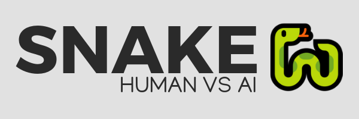
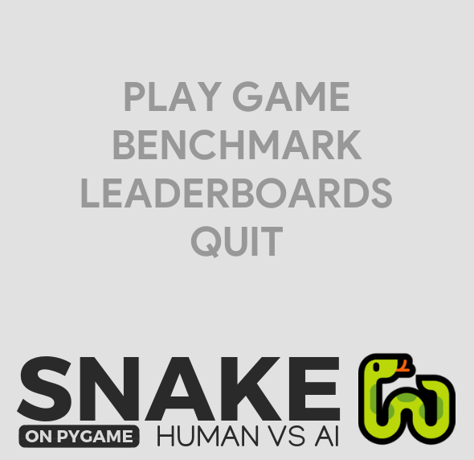
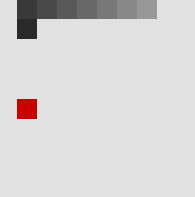

<a id="top"></a>

<div align="center">



<h1>Snake on Pygame</h1>

<p>
  <strong>Classic Snake in Python and Pygame, playable by a person or controlled by a DQN agent.</strong><br />
  <sub>Human vs AI: play it yourself or plug in your own agent</sub>
</p>

<p>
  <a href="https://voaneves.github.io/snake-on-pygame/"><picture><source media="(prefers-color-scheme: dark)" srcset="https://raw.githubusercontent.com/voaneves/snake-on-pygame/master/assets/buttons/landing-dark.svg" /></picture></a>
  <a href="https://github.com/voaneves/snake-on-pygame/archive/refs/heads/master.zip"><picture><source media="(prefers-color-scheme: dark)" srcset="https://raw.githubusercontent.com/voaneves/snake-on-pygame/master/assets/buttons/play-dark.svg" /></picture></a>
</p>

<p><sub>Need something like this? <a href="https://voaneves.com/en/#contact"><strong>Let's talk →</strong></a></sub></p>

<p>
  <a href="https://github.com/voaneves/snake-on-pygame/blob/master/LICENSE"></a>
  
  <a href="https://github.com/voaneves/snake-on-pygame/issues"></a>
</p>

<p>
  <a href="#playing">Play</a> ·
  <a href="#ai-agents">AI agents</a> ·
  <a href="#contributing">Contributing</a> ·
  <a href="#acknowledgments">Acknowledgments</a> ·
  <a href="#contact">Contact</a>
</p>

</div>

<picture>
  <source media="(prefers-color-scheme: dark)" srcset="https://raw.githubusercontent.com/voaneves/snake-on-pygame/master/assets/brand/rule-dark.svg" />
  <source media="(prefers-color-scheme: light)" srcset="https://raw.githubusercontent.com/voaneves/snake-on-pygame/master/assets/brand/rule-light.svg" />
  
</picture>

## Playing

Download the game, run one command and play Snake against the benchmark, which holds scores from AI agents and humans.

<p align="center">
  
</p>

### Prerequisites

You need Python 3.4+ with `pygame`, `numpy` and `pandas`. With [Anaconda](https://www.anaconda.com/), update it first (`conda update conda anaconda`, then `conda update --all`) and install pygame:

```
$ conda install -c cogsci pygame
```

Without Anaconda, use pip:

```
$ pip install pygame numpy pandas
```

### Installing

Clone the repository, or download the ZIP (click **Code**, then **Download ZIP**):

```
$ git clone https://github.com/voaneves/snake-on-pygame.git
```

### Running

The game window lets you choose between single games and the benchmark mode, and between difficulty levels. From the repository root, run:

```
$ python snake.py [-h]
```

In benchmark mode you play 10 games, and your mean score and steps are recorded. To join the leaderboard, open a pull request that changes [`resources/scores.json`](resources/scores.json) or open an issue with your score.

## AI agents

The game follows a [gym](https://github.com/openai/gym)-style API, so you can plug in any agent written in PyTorch, TensorFlow, Theano or Keras. To skip writing the agent, use [colab-rl](https://github.com/voaneves/colab-rl): it already implements agents and wires them to this game.

### Methods and useful properties

Useful properties of the game class:

```
>>> print(game.nb_actions)
5 # number of actions.

>>> print(game.food_pos)
(6, 5) # current position of food.

>>> print(game.steps)
10 # current number of steps in a given episode.

>>> print(game.snake.length)
4 # current length of the snake in a given episode.
```

Methods to integrate with an agent:

```
>>> state = game.reset()
  # Reset the game and return the state right after resetting.

>>> state = game.state()
  # Get the current game state.

>>> game.food_pos = game.generate_food()
  # Update the food position.

>>> state, reward, done, info = game.step(numerical_action)
  # Play a numerical_action: get state, reward, over and info.

>>> game.render()
  # Render the game in a pygame window.
```

### Example usage

One episode with your own agent:

```
from snake-on-pygame import Game
from ai_agent import your_model  # your AI agent of choice

game = Game(player="ROBOT",
            board_size=board_size,
            local_state=local_state,
            relative_pos=RELATIVE_POS)
state = game.reset()

model = your_model()

while not game.game_over:  # main loop, until game_over
    game.food_pos = game.generate_food()

    model.choose_action(state)  # choose action based on the model
    state, reward, done, info = game.step(action)

    model.train(state, reward, game_over, done)
    print(info)

model.test()
```

For more episodes, wrap the `while` loop in a loop over your number of epochs.

### Using colab-rl

[colab-rl](https://github.com/voaneves/colab-rl) lets you experiment with hyperparameters on state-of-the-art algorithms. Its main README has the detailed usage; in short, after cloning it, run:

```
$ python run_dqn.py [-h]
```

Read the file or the repository for all the arguments. A DQN model trained on a 10 x 10 board with no customization looks like this:

<p align="center">
  
</p>

## Contributing

Please read [CONTRIBUTING.md](https://gist.github.com/PurpleBooth/b24679402957c63ec426) for details on the code of conduct and the process for submitting pull requests.

## Acknowledgments

- [@farizrahman4u](https://github.com/farizrahman4u): the [qlearning4k](https://github.com/farizrahman4u/qlearning4k) Snake code was the base of this repository's code.
- [@chuyangliu](https://github.com/chuyangliu): also for his Snake code, which implemented the relative actions.

## Contact

<p>
  <a href="https://voaneves.com/en/#contact"><picture><source media="(prefers-color-scheme: dark)" srcset="https://raw.githubusercontent.com/voaneves/snake-on-pygame/master/assets/buttons/hire-dark.svg" /></picture></a>
  <a href="https://voaneves.com/en/"><picture><source media="(prefers-color-scheme: dark)" srcset="https://raw.githubusercontent.com/voaneves/snake-on-pygame/master/assets/buttons/site-dark.svg" /></picture></a>
</p>

<a href="https://linkedin.com/in/voaneves">LinkedIn</a> · <a href="mailto:victorneves478@gmail.com">E-mail</a>

<p align="center">
  
</p>

<p align="center"><sub>Released under the <a href="https://github.com/voaneves/snake-on-pygame/blob/master/LICENSE">MIT License</a>.</sub></p>

<p align="center"><sub><a href="#top">↑ Back to top</a></sub></p>
